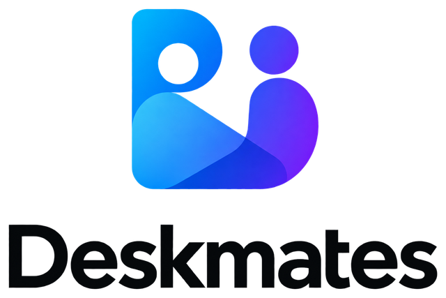
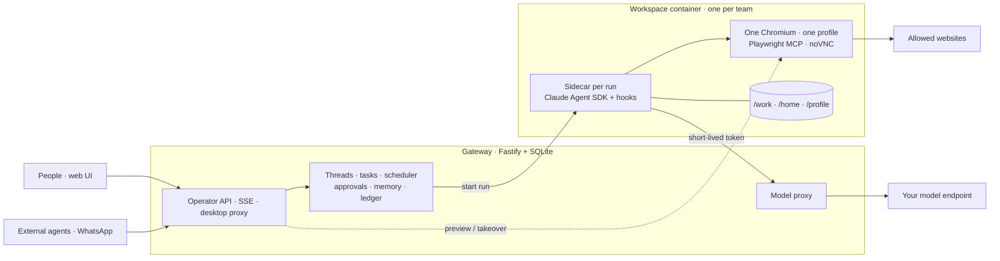

<div align="center">

<picture>
  <source media="(prefers-color-scheme: dark)" srcset="docs/assets/deskmates-lockup-dark.png">
  
</picture>

### AI coworkers that share one computer.

Self-hosted, always-on agents that live together in a sandboxed desktop:
one browser, one shell, one filesystem, one login, like coworkers sharing a desk.

[](LICENSE)
[](package.json)
[](tsconfig.base.json)
[](https://docs.claude.com/en/api/agent-sdk/overview)
[](https://playwright.dev)

[Why](#why-deskmates) · [How it works](#how-it-works) · [Features](#features) · [Quick start](#quick-start) · [Concepts](#concepts) · [Security model](#security-model) · [Development](#development) · [Docs](#documentation)

</div>

---

## Why Deskmates

Most agent frameworks give every agent its own sandbox and then spend their complexity on getting agents to talk to each other. Deskmates starts from the other end: **a team of bots shares one real computer.**

- **One login covers the team.** A human signs in to a site once in the shared Chromium; every bot in the workspace is signed in. No credential plumbing, no per-agent OAuth dance.
- **Files are just files.** Bots read and write the same `/work` directory. Handing work over means leaving it on the desk.
- **Humans can take the keyboard.** Every workspace has a live desktop. Watch a bot work, or take over the browser when it gets stuck and hand it back.
- **Nothing runs without a record.** Every trigger creates a run. Every run keeps its transcript, screenshots, token usage, approvals and the exact configuration it ran with.
- **Risky actions wait for a person.** Reads and reversible writes just happen. External side effects post an approval into the chat, and a run can park for hours until someone answers.

## How it works

A thin control plane (the **Gateway**) schedules work and keeps the ledger. A **workspace** is one Docker container with a persistent browser, desktop and volumes. Each run starts a **sidecar** process inside the workspace that hosts the Claude Agent SDK loop, the product tools and the policy hooks.



The Gateway never calls a model and never imports the Agent SDK. The sidecar never sees a long-lived credential. The model is configuration: point `MODEL_BASE_URL` at any Anthropic-compatible Messages endpoint.

## Features

| | |
|---|---|
| **Shared workspace** | One Chromium profile, shell and filesystem per team. Desktop previews, human takeover, file browser and downloads in the UI. |
| **Chats that wake bots** | Private and group chats with mentions, `@everyone`, owner-first routing and bot-to-bot handoffs. Relay and turn caps stop runaway exchanges. |
| **Two lanes per bot** | An interactive lane for chat and approvals, a background lane for cron, webhooks and bus messages. One run per lane. |
| **Approvals that park** | Tool calls are tiered in a `PreToolUse` hook. External effects wait for a decision; stored rules answer repeat cases; a parked run resumes with its session intact. |
| **Tasks and delivery** | Tasks carry ownership, blockers, linked runs and artifacts. Bots declare delivery; humans accept. External agents submit work through an idempotent API or the bundled MCP server. |
| **Memory with provenance** | Canonical bot instructions, versioned learned memory in task, workspace and bot scopes, and FTS5 knowledge search. Rules stay human-owned. |
| **Costs you can audit** | Per-model token counts from every run, priced by your own table. Unknown prices are never silently zero. Budgets and alerts per workspace. |
| **People and roles** | Owner, Admin, Member and Guest per workspace. Sessions, invitations, service principals and optional OIDC sign-in. |
| **Egress by choice** | Open internet by default, or lock a workspace to a domain allowlist with first-visit approvals. A managed proxy keeps private addresses out of reach. |
| **Channels and connectors** | WhatsApp (QR-linked or Cloud API), a receipted PostgreSQL connector, and an optional SaaS integration runtime. |

## Quick start

You need **Node 22+**, **Docker** (on macOS: `colima start`) and an Anthropic-compatible Messages endpoint that accepts Bearer auth.

```bash
git clone git@github.com:TolemyW/deskmates.git
cd deskmates
npm ci
cp .env.example .env
```

Edit `.env` and set `MODEL_BASE_URL`, `MODEL_AUTH_TOKEN`, `DEFAULT_MODEL` and `CHEAP_MODEL`. Add the models' rates to `MODEL_PRICES` so cost accounting works. Everything else has a documented default in [`.env.example`](.env.example).

Build the packages and the two runtime images, then start the Gateway:

```bash
npm run build
npm run image:workspace
bash scripts/build-egress-image.sh
npm run dev:gateway
```

In a second terminal, create the first Owner and start the UI:

```bash
npm run auth -- bootstrap-owner --login owner --name "Local Owner"
npm run dev:web
```

Open **http://localhost:5173**, sign in, create a workspace and a bot, and say hello. Bootstrap is a one-time step; later starts need only the two dev servers.

| Port | What |
|---|---|
| `5173` | Vite UI, proxies `/auth`, `/api` and `/hooks` to the operator listener |
| `8081` | Operator API, SSE and desktop proxy (loopback by default) |
| `8080` | Sandbox callbacks and model proxy, used by workspaces only |

For a long-lived installation with HTTPS, persistent credentials and backups, follow the [stable release runbook](docs/runbooks/stable-release.md). For UI-only work, `npm run dev:ui` opens the component studio without a Gateway, Docker or model.

## Concepts

- **Workspace.** One container, one team. The isolation boundary. Anything that must not share a login or a file goes in a second workspace.
- **Bot.** A name, a role and a `SOUL.md`. Bots in a workspace are separated by instructions and attribution, not by access control.
- **Thread.** A chat with members. The Gateway owns the transcript; each bot keeps its own SDK session per thread and is woken with what it has not seen.
- **Run.** One execution of one bot on one lane. Created before anything happens, kept forever.
- **Approval.** A system message in the thread with the proposed action. Any member may decide it, from the UI or through a tool.

## Security model

Deskmates is honest about where its boundaries are.

- **The workspace is the boundary, not the bot.** Bots in one workspace share cookies, files, shell and process environment. Roles, tool lists and ownership are conventions. A new trust domain costs one more container, never a permission subsystem.
- **Page content is untrusted.** Browser output is wrapped before it enters model context. Tokens and cookies are redacted before anything reaches the ledger. Screenshots are not redacted.
- **Credentials stay on the Gateway host.** Workspaces receive a short-lived run token and reach the model through the Gateway's proxy. The database never holds a plaintext password, cookie or upstream model key.
- **Open-internet workspaces hold no production credentials.** That is the default grouping rule, and the docs do not pretend otherwise.

The full rules, with the tests that enforce each one, are in [`AGENTS.md`](AGENTS.md).

## Development

```
packages/contracts        shared types and protocol, zero runtime deps
packages/gateway          control plane: Fastify + SQLite + forward-only migrations
packages/sidecar          runs inside the workspace; the only package that imports the Agent SDK
packages/sandbox-docker   Docker implementation of SandboxProvider
packages/web              React + Vite operator UI with the bundled manual
packages/ui               owned HeroUI component library and studio
packages/channels         WhatsApp adapters and the agent MCP server
packages/connector-postgres  standalone receipted PostgreSQL connector
packages/testkit          fake SDK, fake provider, fixtures (dev only)
packages/golden-site      Galaxy Ops Console, the deterministic site the benchmark runs against
images/                   workspace, egress proxy and connector images
evals/                    the 48-task deskbench suite and A/B tooling
docs/                     operator guide, runbooks, design docs, ADRs
```

Tests are tiered by filename, and every tier has a clear cost:

| Tier | Suffix | Needs | Command |
|---|---|---|---|
| T0 / T1 | `*.test.ts` | nothing: fake SDK, no Docker | `npm test` |
| T2 | `*.container.test.ts` | Docker | `npm run test:container` |
| T3 | `*.acceptance.test.ts` | Docker + a real model | `npm run test:acceptance` |
| T4 | `evals/` | Docker + a real model | `npm run evals` |

The local gate before a PR is ready:

```bash
npm run typecheck && npm run lint && npm run docs:check && npm test
```

Whether a change made the agent *better* is not a matter of opinion here. Strategy changes (prompts, memory rules, approval rules, retrieval knobs) are measured with a paired A/B run on the [deskbench](docs/design/benchmark-2026-09-20.md) suite against the golden site, following the [measurement protocol](docs/design/measurement-2026-09-20.md). A single run is not evidence.

## Documentation

| Read this | For |
|---|---|
| [Operator manual](docs/guide/README.md) | Day-to-day use: workspaces, bots, chats, tasks, approvals, people, costs |
| [`AGENTS.md`](AGENTS.md) | Working in this repo: architecture rules, conventions, commands |
| [Architecture](docs/design/design-cogbot-thin-core-v0.3-2026-09-20.md) | The canonical blueprint |
| [ADRs](docs/adr/) | Every decision, each with a verification table |
| [Stable release runbook](docs/runbooks/stable-release.md) | Installing, upgrading, backing up and rolling back |
| [External-agent access](docs/guide/using-deskmates-from-another-agent.md) | Connecting another agent through a service principal or the MCP server |
| [Test strategy](docs/design/test-strategy-2026-09-20.md) | Tiers, test doubles, fault and security checklists |

## Project status

Deskmates is pre-1.0 and under active development. The runtime, the developer workflow and the features above are implemented; milestone acceptance is tracked separately and deliberately, so a merged feature or a green CI run is not a claim that every runtime, model or statistical gate has passed.

<details>
<summary>Current milestone contract</summary>

<!-- current-status:start -->
M3 is closed under the owner-revised scope. M4 is in progress.
Task management (ADR-0021) is merged; runtime, real-model, statistical,
visual acceptance remain pending.
Natural 24-hour soak is not an M4 gate; validation continues after stable release.
<!-- current-status:end -->

Evidence and open gates are in the [M4 status ledger](docs/design/m4-status-2026-10-04.md). Open design questions are listed at the end of [`AGENTS.md`](AGENTS.md#open-decisions).

</details>

## Contributing

1. Read [`AGENTS.md`](AGENTS.md). It is the contract for humans and agents alike.
2. A change that breaks an architecture rule needs an ADR first, with a verification table.
3. Keep PRs as drafts while iterating, run the local gate, then mark ready. CI is the merge gate, not a debugging loop.
4. Secrets never enter a tracked file. Commit messages: imperative subject, body explains why.

## License

[GNU General Public License v3.0](LICENSE)
